# 🚀 Multi-Stage Java Application Deployment on AWS EC2 & Apache Tomcat

An enterprise-grade, automated **Continuous Integration & Continuous Deployment (CI/CD)** pipeline built with **GitHub Actions**, **Apache Maven**, **Apache Tomcat 10/11**, and **AWS EC2 Golden AMI** (`MultiDeployImage`).

This project demonstrates how a Java Enterprise Web Application is compiled, tested, packaged into a `.war` file, and progressively promoted across four isolated environments (**DEV**, **TEST**, **PRE-PROD**, and **PROD**) with **Golden AMI provisioning** and **GitHub Environment Manual Approval Gates**.


## 🏛 Architecture & Staged Promotion Workflow

The deployment follows a **Staged Promotion Model** where an immutable artifact (`task-manager.war`) is built once and progressively promoted through sequential quality gates.

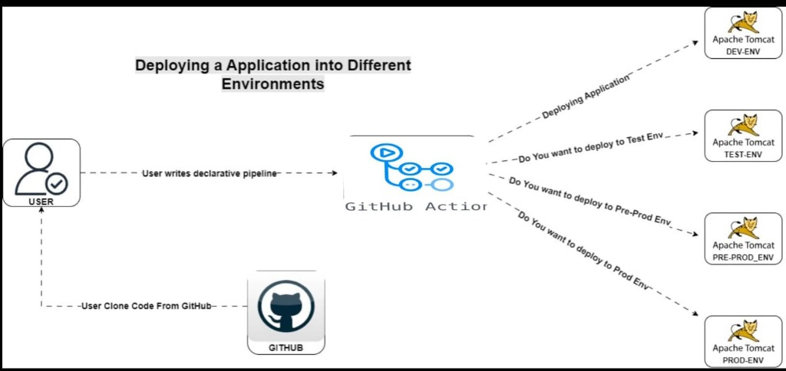

### Workflow Lifecycle:
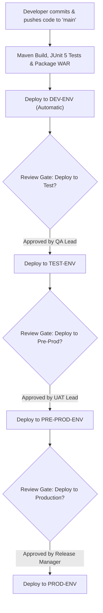

---

## 🔄 What Happens When Code is Committed? (Real-Time vs Pipeline)

### In This Pipeline:
1. **Developer pushes commit to `main`**:
   - GitHub Actions automatically triggers the `Build & Deploy Multi-Stage Pipeline`.
2. **Build Stage executes**:
   - OpenJDK 17 environment is initialized on the runner.
   - `mvn clean test` runs the JUnit 5 test suite. If any test fails, the pipeline immediately aborts.
   - `mvn package` packages `target/task-manager.war`.
   - The compiled WAR artifact is uploaded to GitHub Actions storage with a 7-day retention period.
3. **Automatic Dev Deployment**:
   - The artifact is fetched and deployed to the `DEV` server (`18.60.39.98:8080`) without requiring any approval.
   - Health check against `/task-manager/health` verifies application status.
4. **Approval Gate for TEST**:
   - The pipeline pauses before `deploy-test`.
   - Designated reviewers receive an email / GitHub notification with a review prompt.
   - When approved (e.g. comment *"accepted"*), `task-manager.war` deploys to the `TEST` server (`98.130.122.16:8080`).
5. **Approval Gate for PRE-PROD**:
   - After QA and integration tests pass, the reviewer approves promotion to `PRE-PROD` (`18.60.42.233:8080`) for User Acceptance Testing (UAT) and staging validation.
6. **Approval Gate for PROD**:
   - Once stakeholder sign-off is complete, the final gate is reviewed and approved, triggering atomic deployment to `PROD` (`18.61.83.143:8080`).

### How Real-Time Enterprise Teams Handle Promotions:
In an enterprise multi-developer team:
* **Branch Strategy**:
  - Developers work on feature branches (`feature/task-xyz`).
  - Feature branches merge to `develop` via Pull Request (PR) after peer review and automated CI checks.
  - Pushes to `develop` trigger automatic deployment to **DEV** and **TEST**.
  - A release candidate branch (`release/v1.2.0`) deploys to **PRE-PROD** (Staging) for end-to-end UAT.
  - Merging `release/v1.2.0` into `main` creates an immutable Git tag (e.g. `v1.2.0`) and requires formal approval before releasing to **PROD**.
* **Rollback Strategy**:
  - If a critical bug is found in Production, the previous known good WAR artifact can be redeployed within seconds by re-running the last successful GitHub Actions run or by deploying the previous tagged release artifact.

---

## 📁 Project Directory Layout

```text
multistage-deployops/
├── .github/
│   └── workflows/
│       └── deploy.yml              # Multi-stage declarative CI/CD pipeline with approval gates
├── docs/
│   └── images/                     # Full-resolution architectural & deployment screenshots
│       ├── architecture-diagram.jpg
│       ├── aws-ami-summary.png
│       ├── aws-ec2-instances-fleet.png
│       ├── tomcat-systemd-active.png
│       ├── github-environments-setup.png
│       ├── approval-gate-test.png
│       ├── approval-gate-prod.png
│       ├── github-actions-deploy-success.png
│       ├── app-live-dev.png
│       ├── app-live-test.png
│       ├── app-live-preprod.png
│       └── app-live-prod.png
├── scripts/
│   └── setup-tomcat.sh             # Base AMI automated server provisioning script
├── src/
│   ├── main/
│   │   ├── java/com/
│   │   │   ├── example/web/
│   │   │   │   └── HealthServlet.java   # /health probe endpoint
│   │   │   └── taskmanager/
│   │   │       ├── Main.java            # Local standalone entry point
│   │   │       ├── model/Task.java      # Task domain model
│   │   │       ├── service/TaskService.java  # Thread-safe business logic
│   │   │       └── web/
│   │   │           ├── HelloServlet.java     # Full CRUD Tomcat Servlet
│   │   │           └── TaskWebServer.java    # Embedded HTTP server for local testing
│   │   └── webapp/
│   │       ├── index.html          # Clean Task Management web interface
│   │       └── index.jsp           # Dynamic JSP landing page
│   └── test/
│       └── java/com/taskmanager/service/TaskServiceTest.java # JUnit 5 test suite
├── pom.xml                         # Maven dependencies & build configuration (Java 17, Servlet 6.1)
├── .gitignore                      # Git ignore rules for Java, Maven & OS files
└── README.md                       # Comprehensive documentation
```

---

## 🖥 Phase 1: Golden AMI Strategy & Base Server Setup

### Why Golden AMI?
In multi-server deployments, installing and configuring software manually on each instance causes **configuration drift**, missed dependencies, and human error.

### 1. Base Server Setup
Run the automated script [`scripts/setup-tomcat.sh`](scripts/setup-tomcat.sh) on the base EC2 instance:
1. Installs **OpenJDK 17**:
   ```bash
   sudo apt-get update && sudo apt-get install -y openjdk-17-jdk
   ```
2. Downloads and installs **Apache Tomcat 10.1+** under `/opt/tomcat`.
3. Creates a dedicated `tomcat` system user and group.
4. Configures `conf/tomcat-users.xml` with the `manager-script` role for remote deployment.
5. Updates `webapps/manager/META-INF/context.xml` by commenting out `RemoteAddrValve` to permit remote deployment from GitHub Actions runners.
6. Sets up `/etc/systemd/system/tomcat.service` and enables the service:
   ```bash
   sudo systemctl daemon-reload
   sudo systemctl enable tomcat
   sudo systemctl start tomcat
   ```

### 2. Verifying Systemd Service Status
Before capturing the AMI, verify that the Tomcat service is active, running, and enabled for automatic boot start:

```bash
systemctl status tomcat
```

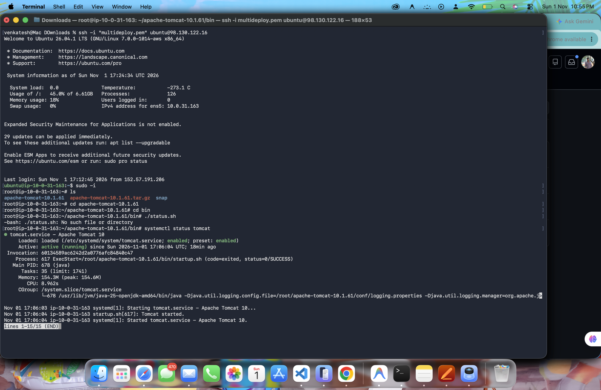

### 3. Capturing the Golden AMI
In the **AWS EC2 Console**, right-click the configured base instance > **Image and templates** > **Create image**:
* **AMI Name**: `MultiDeployImage`
* **AMI ID**: `ami-0e766abb01956e2dd`
* **AWS Region**: `ap-south-2` (Asia Pacific - Hyderabad)
* **Status**: `Available`

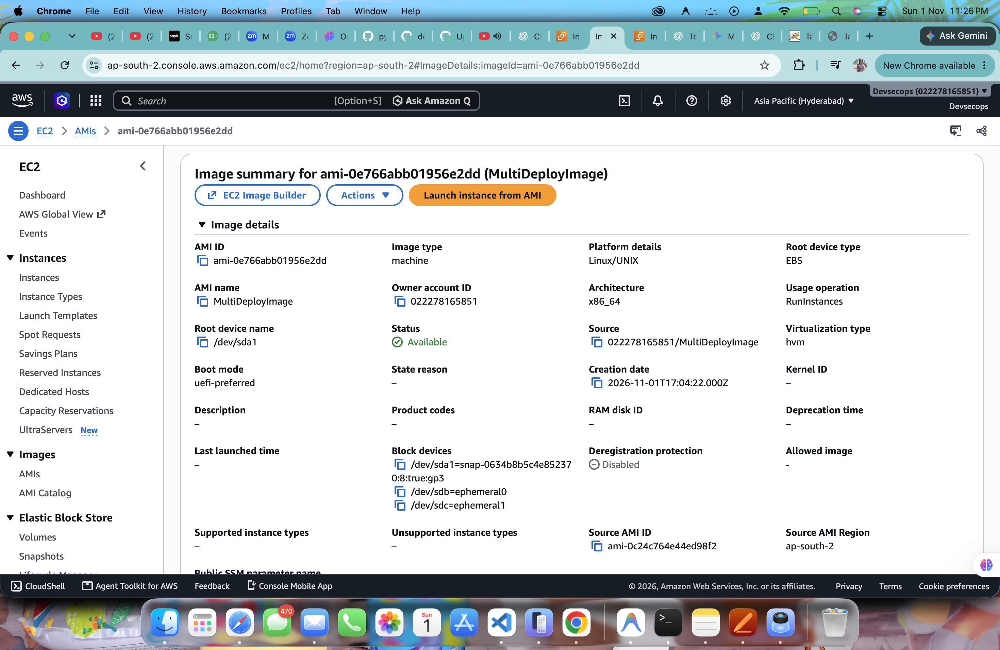

---

## ☁️ Phase 2: AWS EC2 Multi-Environment Fleet Provisioning

Using the captured Golden AMI (`ami-0e766abb01956e2dd`), four identical EC2 instances were launched in region `ap-south-2` (Availability Zone `ap-south-2a`):

| Environment | EC2 Instance Name | Instance ID | Type | Public IPv4 Address | Port | Purpose |
| :--- | :--- | :--- | :--- | :--- | :--- | :--- |
| **DEV** | `Dev-Server` | `i-090ed6155bdee63e9` | `t3.small` | `18.60.39.98` | `8080` | Continuous integration & smoke testing |
| **TEST** | `Test-Server` | `i-0aa3158a016529438` | `t3.small` | `98.130.122.16` | `8080` | QA automated & manual testing |
| **PRE-PROD** | `PreProd-Server` | `i-0c38a52d2e2a7ff55` | `t3.small` | `18.60.42.233` | `8080` | Staging & User Acceptance Testing (UAT) |
| **PROD** | `Prod-Server` | `i-0fd1183099197f0bd` | `t3.small` | `18.61.83.143` | `8080` | Customer-facing live production environment |

### AWS EC2 Fleet Console:
All four instances are launched from `MultiDeployImage` with 3/3 status checks passed:

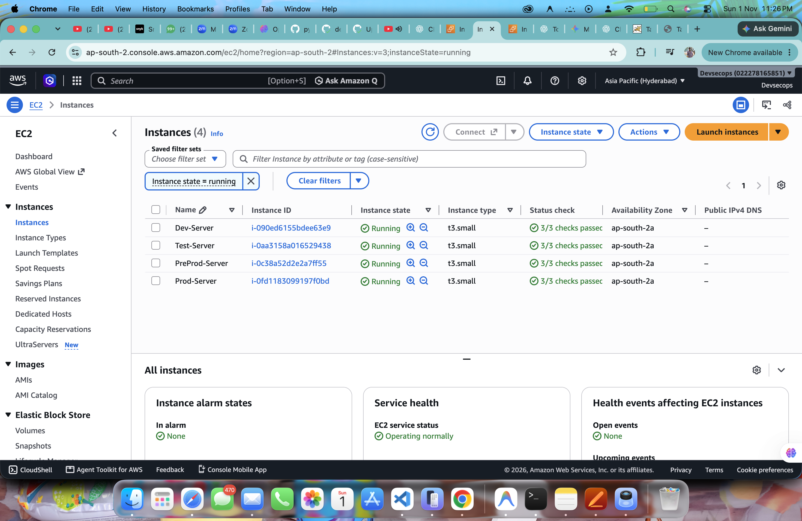

> [!NOTE]
> Each instance's AWS Security Group has Inbound rules configured for:
> - **Port 22 (SSH)** from administrator IP.
> - **Port 8080 (Custom TCP)** from `0.0.0.0/0` (or GitHub runner CIDRs) to allow Tomcat web access and WAR uploads.

---

## 🔐 Phase 3: GitHub Environments & Secrets Configuration

To isolate environment credentials and enforce approval gates, four **GitHub Environments** were configured under **Settings > Environments**:

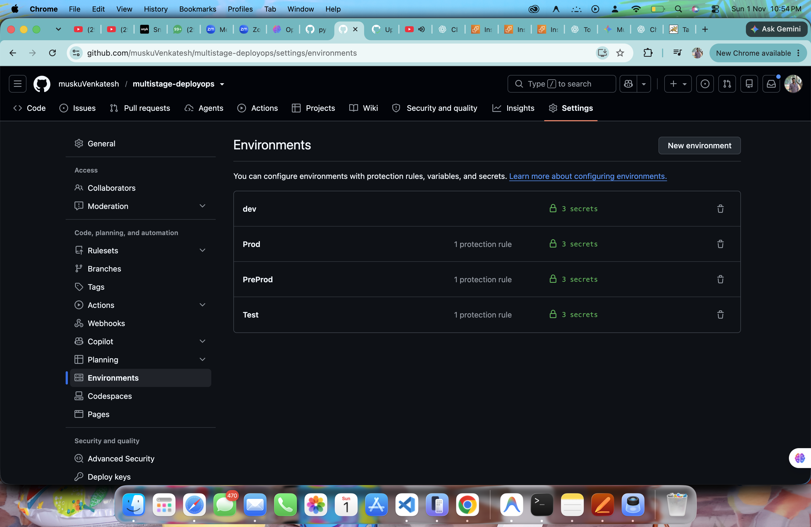

### Protection Rules & Configuration:
* **`dev`**:
  - Protection Rules: **None** (Automatic deployment on every push).
  - Environment Secrets: `TOMCAT_HOST`, `TOMCAT_USER`, `TOMCAT_PASSWORD`.
* **`Test`**:
  - Protection Rules: **1 Required Reviewer** (`muskuVenkatesh`).
  - Environment Secrets: `TOMCAT_HOST`, `TOMCAT_USER`, `TOMCAT_PASSWORD`.
* **`PreProd`**:
  - Protection Rules: **1 Required Reviewer** (`muskuVenkatesh`).
  - Environment Secrets: `TOMCAT_HOST`, `TOMCAT_USER`, `TOMCAT_PASSWORD`.
* **`Prod`**:
  - Protection Rules: **1 Required Reviewer** (`muskuVenkatesh`).
  - Environment Secrets: `TOMCAT_HOST`, `TOMCAT_USER`, `TOMCAT_PASSWORD`.

### Environment Secrets Breakdown:
| Secret Name | Value Example | Description |
| :--- | :--- | :--- |
| `TOMCAT_HOST` | `http://18.60.39.98:8080` | Target EC2 instance public IP and Tomcat port |
| `TOMCAT_USER` | `manager` | Username configured with `manager-script` role in Tomcat |
| `TOMCAT_PASSWORD` | `********` | Strong secret password for Tomcat Manager deployment |

---

## 🚦 Phase 4: Declarative CI/CD Pipeline & Approval Gates

The complete pipeline is defined in [`.github/workflows/deploy.yml`](.github/workflows/deploy.yml).

### Manual Approval Gates in Action:

#### 1. Approving Promotion to TEST:
When the `deploy-dev` job completes successfully, the pipeline automatically halts before `deploy-test` and requests review. The reviewer inspects changes, enters review notes (e.g., *"accepted"*), and clicks **Approve and deploy**:

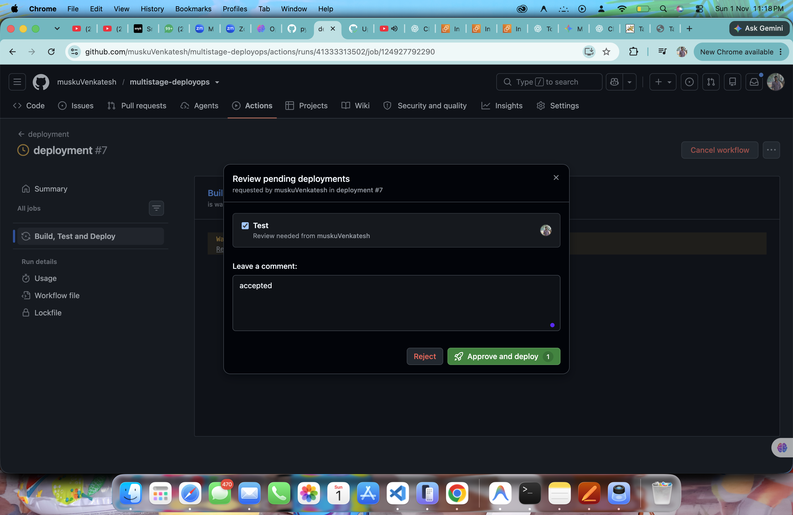

#### 2. Approving Promotion to PROD:
Following QA verification on Test and UAT sign-off on Pre-Prod, the final approval gate is triggered for Production:


Clicking **Approve and deploy** initiates the production deployment step.

---

## ✅ Phase 5: Automated Deployment Execution & Verification

### Deployment Step via Tomcat Manager API:
The deployment script uses `curl` to upload the compiled WAR directly into the running Tomcat container:

```bash
set -eu

WAR_FILE="target/task-manager.war"

if [ ! -f "$WAR_FILE" ]; then
  echo "ERROR: WAR file was not generated."
  exit 1
fi

TOMCAT_HOST="${TOMCAT_HOST%/}"

echo "Deploying application to $TOMCAT_HOST"

RESPONSE=$(curl --fail-with-body --show-error --silent \
  --connect-timeout 15 \
  --max-time 300 \
  --user "$TOMCAT_USER:$TOMCAT_PASSWORD" \
  --upload-file "$WAR_FILE" \
  "$TOMCAT_HOST/manager/text/deploy?path=/task-manager&update=true")

echo "$RESPONSE"

if ! echo "$RESPONSE" | grep -q "^OK -"; then
  echo "ERROR: Tomcat deployment failed."
  exit 1
fi

echo "Application deployed successfully."
```

### Health Verification Endpoint:
Immediately following deployment, the pipeline polls the health endpoint:
```bash
curl --fail --silent --show-error "$TOMCAT_HOST/task-manager/health"
```

### GitHub Actions Deployment Logs:
The job output verifies successful deployment and HTTP 200 health check response:

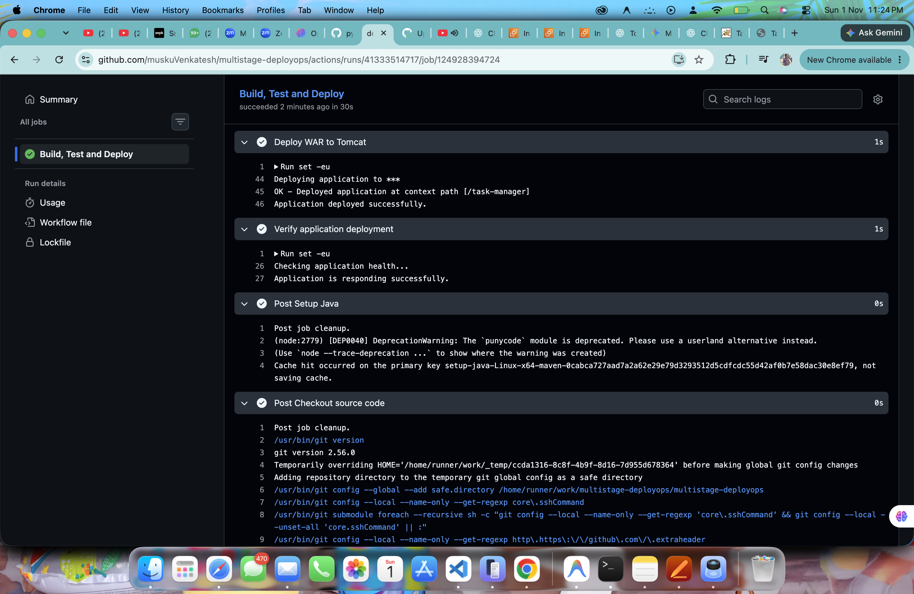

---

## 🌐 Phase 6: Live Verified Deployments Across All 4 Environments

All four environments are verified and actively serving the Task Management application:

### 1. DEV Environment
* **URL**: `http://18.60.39.98:8080/task-manager/`
* **Instance**: `Dev-Server` (`i-090ed6155bdee63e9`)

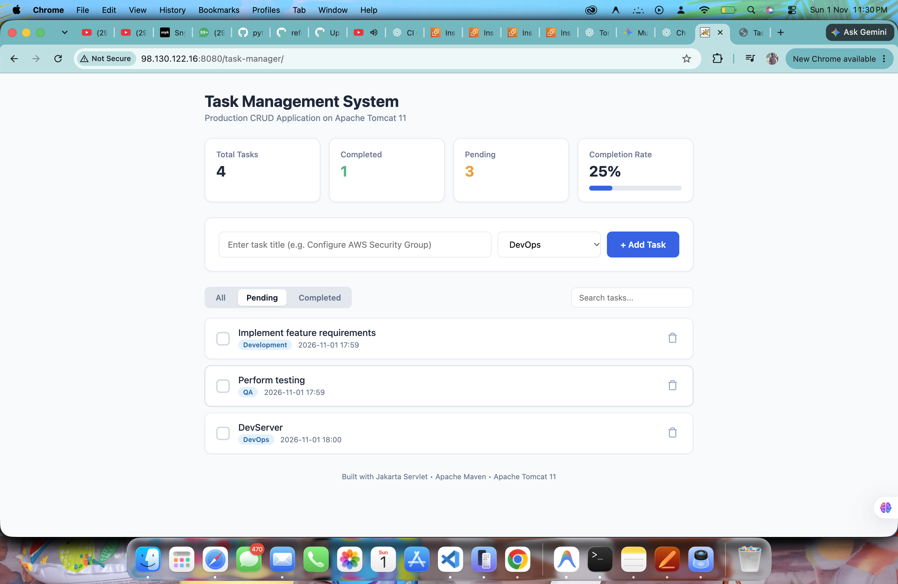

---

### 2. TEST Environment
* **URL**: `http://98.130.122.16:8080/task-manager/`
* **Instance**: `Test-Server` (`i-0aa3158a016529438`)

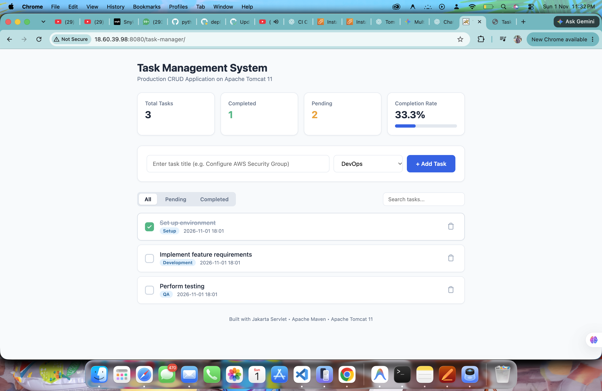

---

### 3. PRE-PROD Environment
* **URL**: `http://18.60.42.233:8080/task-manager/`
* **Instance**: `PreProd-Server` (`i-0c38a52d2e2a7ff55`)

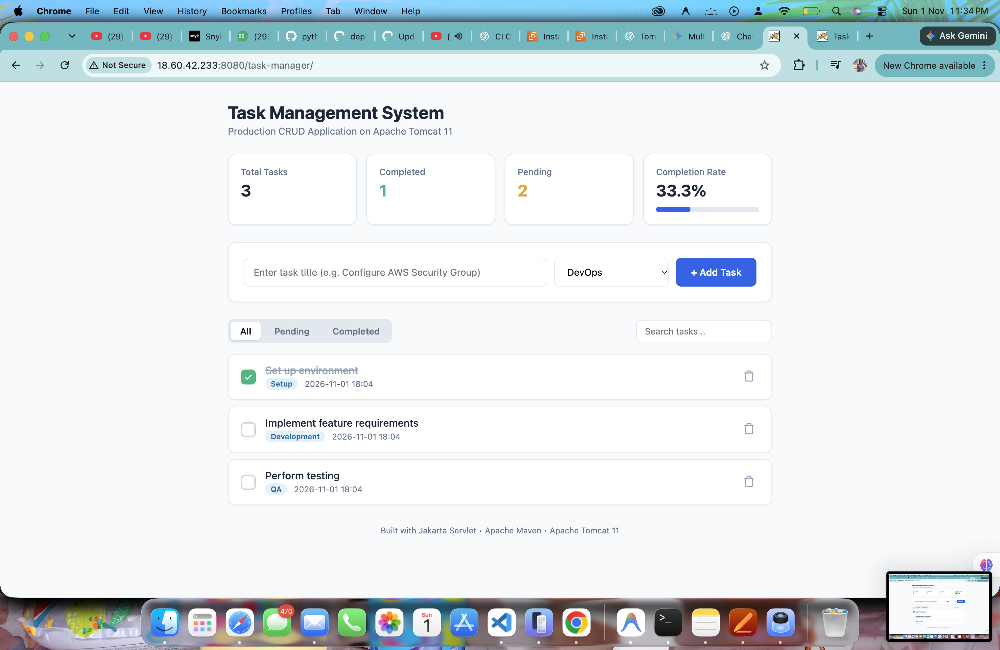

---

### 4. PROD Environment
* **URL**: `http://18.61.83.143:8080/task-manager/`
* **Instance**: `Prod-Server` (`i-0fd1183099197f0bd`)

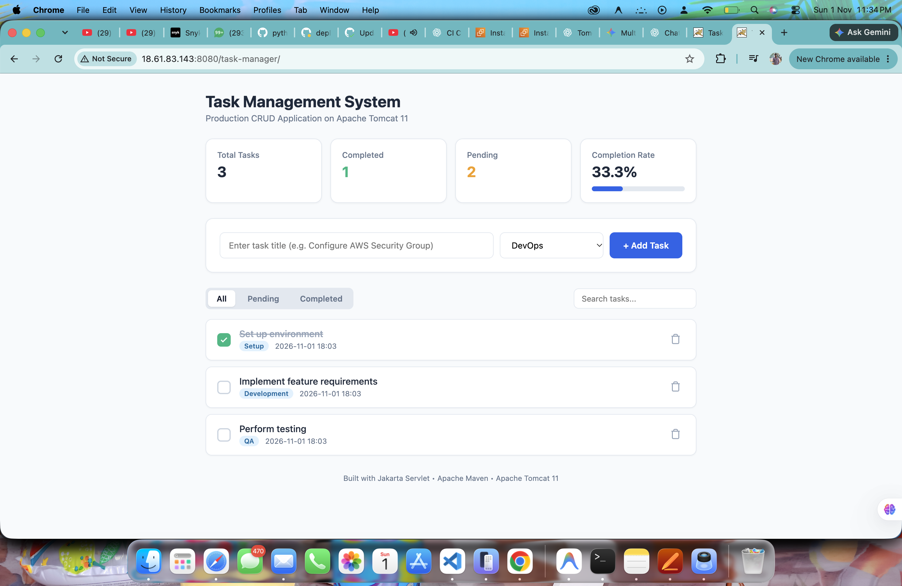

---


## 👤 Author
**Venkatesh Musku**  
GitHub: [@muskuVenkatesh](https://github.com/muskuVenkatesh)  
Repository: [`muskuVenkatesh/multistage-deployops`](https://github.com/muskuVenkatesh/multistage-deployops)
